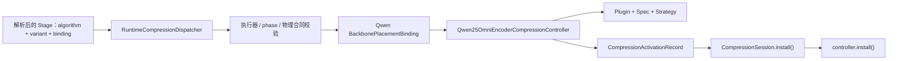
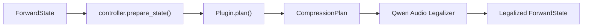
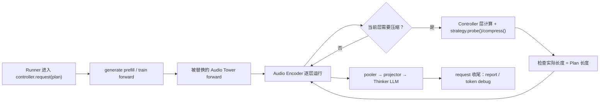

# Qwen2.5-Omni Encoder-Level 音频压缩：架构、扩展与最小 Debug

> 类型：Backbone-specific Architecture / Debug Reference
> 适用范围：Qwen2.5-Omni 的 `encoder_token` 执行族
> 当前实现：A-ToME、Encoder Attention Top-K、Progressive Pruning
> 最后按代码核对：2026-08-24

本文回答三个问题：

1. Encoder-Level 压缩在当前代码中如何运行；
2. A-ToME 重构后，算法、执行族和 Qwen 适配分别在哪里；
3. 如何借助这个实例理解新增 Encoder-Level 方法，而不是复制一套旧实现。

本文不再维护依赖源码行号的逐断点脚本。行号会随重构失效，以下 Debug 入口全部按
稳定符号给出。A-ToME 的算法身份和验收结论见
[八方法契约](../eight_methods_contract.zh.md#p2)，自动验证命令见
[八方法 Runbook](../eight_methods_runbook.zh.md)。真正新增通用压缩方法时，以
[开发压缩方法指南](../../../../guides/2_dev_compression_method.zh.md)为唯一教程。

## 0. 现在应该怎么读

如果 A-ToME 已经通过 O/E/T 验证，不需要重新逐步证明 cosine、pair 和 mean merge：

1. 先读第 1 章，建立当前调用链；
2. 再读第 2、3 章，区分共享执行族与 A-ToME 算法；
3. 按第 4 章走一遍代码；
4. 用第 5 章理解未来如何新增 Encoder-Level 方法；
5. 只有自动回归失败时，才使用第 6 章人工 Debug。

如果目标只是定位现有故障，直接从第 6 章开始。本文不重复 Backbone baseline、正式
benchmark、训练收敛和发布验收；这些分别由 pipeline 手册、实验协议和状态页负责。

## 1. 把“调用链”拆成三个阶段

当前 Omni 方法通过完整的多模态 v2 身份进入通用 `CompressionSession`；Algorithm
内部仍复用已经验证的 Spec/Strategy，但不存在独立的 legacy registry/runtime 路径。

这里不能把所有节点理解成一条普通 Python 调用栈。完整流程发生在三个不同时间：

1. 加载模型和配置时，组装并安装压缩组件；
2. 每个样本进入模型前，规划长度并修复输入布局；
3. 模型真正 forward 时，执行打分、选择和压缩。

下面图中的箭头表示“选择、构造或时间顺序”，不一定表示左侧函数直接调用右侧函数。

### 1.1 阶段一：启动时组装压缩方法

配置解析会补齐能够唯一推导的身份；候选有歧义时必须显式选择。
下面的运行校验检查可执行工厂、phase、物理位置和模型结构。SupportUnit 单独记录支持
状态与证据；合法研究方法不需要先有 SupportUnit，也不会因一次运行自动获得正式支持。



这一阶段只回答“之后应该由谁执行压缩”，不会读取本轮音频，也不会真正合并 Token。

| 节点 | 输入 | 具体做什么 | 产出 |
| --- | --- | --- | --- |
| YAML Stage | 用户配置 | 声明 algorithm、Audio Variant、Qwen Binding、参数和 execution phase | 一个启用的 v2 压缩 Stage |
| `RuntimeCompressionDispatcher` | 配置、Facade、Runtime | 复用已解析的 Algorithm/Variant/Binding，检查运行物理合同并组织 Session | 待安装的 `CompressionSession` |
| `BackbonePlacementBinding` | Algorithm + Audio Variant | 声明 Qwen target site、`executor_family`、handles 和支持 phase | 精确 Qwen 接入合同 |
| Spec | Stage 参数 | 解析默认值并拒绝非法组合，例如错误层号或压缩率 | 规范化、只读的算法参数 |
| Plugin | Spec 和输入状态 | 提供该方法的 Plan 逻辑；本阶段只被创建，尚未规划样本 | Plan provider |
| Strategy | Spec | 提供运行时打分、选择和 merge/drop 算法；本阶段只被创建 | 算法执行对象 |
| Encoder Controller | Binding、Spec、Strategy、Qwen 模型 | 持有共享 Encoder 执行逻辑和 Qwen 修复逻辑 | 可安装的 Controller |
| `CompressionSession.install()` | Activation records | 按顺序安装本次启用的压缩 Stage | 已安装 Session |
| `controller.install()` | Qwen 模型 | 替换 Audio Tower forward、output-length 和 M-RoPE 入口 | 之后的模型调用会进入压缩路径 |

需要注意：Binding 不是算法。Algorithm/Spec/Strategy 拥有算法语义，Binding 只负责
Qwen 物理插入点与运行时不变量，SupportUnit 负责精确 phase 的状态和证据。

### 1.2 阶段二：每个请求开始前规划长度



这一阶段回答“本轮样本预计会剩多少 Token，以及 LLM 输入应该按多长准备”。它仍然不会
根据真实 hidden states 选择具体 Token。

| 节点 | 输入 | 具体做什么 | 产出 |
| --- | --- | --- | --- |
| `ForwardState` | Processor 结果 | 保存 Audio span、feature length、input IDs、mask 等本轮输入信息 | 可供压缩规划的统一状态 |
| `controller.prepare_state()` | `ForwardState` | 组织 Plan 和 Legalizer，不实现 A-ToME 数学 | Legalized state 与 Plan |
| `Plugin.plan()` | State、Spec、Audio Encoder 结构 | 根据 feature/chunk 长度、active layers 和比例推导每层预计长度 | `CompressionPlan` |
| `CompressionPlan` | 规划结果 | 记录每个 audio unit 的初始长度、逐层目标长度和最终 Audio Token 预算 | 本轮长度合同 |
| Qwen Audio Legalizer | State、Plan | 按最终预算 compact Audio placeholders，并同步相应 mask、position 和语义布局 | 可送入 Qwen 的合法输入状态 |

以 A-ToME 为例，Plan 只知道：

```text
第 2 层：100 → 90
第 5 层： 90 → 81
最终 pooler 后：需要 K 个 LLM Audio placeholders
```

它不知道第 2 层具体合并 `(0,1)` 还是 `(6,7)`。因此 A-ToME 的 Plan action 会标记
`selection_deferred=True`：长度现在决定，内容相关的 pair 选择留到真正 forward。

### 1.3 阶段三：模型 forward 时真正执行压缩



这一阶段才会读取真实 hidden states，真正打分并改变张量长度。

| 节点 | 输入 | 具体做什么 | 产出 |
| --- | --- | --- | --- |
| `controller.request(plan)` | 本轮 Plan | 建立仅对当前请求生效的长度和 telemetry 上下文 | Active request context |
| `generate` prefill / 训练 `forward` | Legalized state | 调用模型；首次处理音频时进入 Audio Tower | 原生模型执行开始 |
| 被替换的 Audio Tower forward | Audio features、feature lengths | 按 Qwen chunk 规则运行变长 Encoder loop | 逐层 hidden states |
| Controller | 当前层、当前 chunk lengths | 判断 Strategy 是否启用，并向下一层传递新的 `cu_seqlens` | 合法的变长 Encoder 流程 |
| `strategy.probe()`（评分扩展） | 归一化层输入、评分层、chunk boundaries | 获得算法所需的 Q/K 或 attention 分数 | 评分上下文 |
| `strategy.compress()` | 应用边界的 hidden states、评分上下文、chunk boundaries | 选择、merge/drop，并保持每个 chunk 独立 | 特征、实际长度、报告、重放计划 |
| `strategy.replay()` | 特征与已保存的计划 | 重放选择或均值合并，保持值路径的梯度 | 压缩后的特征 |
| 长度检查 | Strategy 实际输出、Plan 预计输出 | 要求两者完全相等，防止后续 pooler、placeholder 和 M-RoPE 错位 | 可继续运行的下一层输入 |
| pooler / projector / Thinker LLM | 压缩后的 Encoder 输出 | 生成 LLM Audio embeddings，并完成 prefill、decode 或训练 loss | 文本输出或 loss |
| request 收尾 | 实际执行记录 | 汇总 active layers、压缩前后 Token 数和耗时/调试信息 | Compression report |

评估时 Audio Encoder 只在 `generate()` 的 prefill 处理音频；后续 decode 不会反复运行
Encoder 压缩。训练时则在直接 `forward()` 中执行一次，然后进入 backward。

### 1.4 用一次 A-ToME 请求串起来

```text
启动：
YAML 指定完整 adjacent_token_merging_audio v2 身份
  → Qwen Binding 查到 encoder_token + QwenAdjacentMergingEncoderStrategy
  → 构造并安装 Qwen25OmniEncoderCompressionController

请求前：
ForwardState 提供 Audio span 和 feature length
  → Plugin.plan() 计算每个 active layer 的预计长度
  → Legalizer 把 LLM Audio placeholders compact 到最终 K

forward：
Audio Encoder 到达 active layer
  → Controller 用归一化层输入调用 Strategy.probe()，获得 K
  → Controller 执行原生 MHSA + residual，到达默认压缩边界
  → Strategy.compress() 根据 normalized-key cosine 选择不相交相邻 pair 并取 mean
  → Controller 对短序列执行当前层 FFN + residual
  → Controller 校验实际长度与 Plan 相等，更新下一层 cu_seqlens
  → pooler / projector / Thinker LLM
  → request 结束时生成 report
```

### 1.5 每个概念只记一句话

| 概念 | 一句话记忆 |
| --- | --- |
| YAML Stage | 我要使用哪个方法、哪些参数、在哪个生命周期执行 |
| Algorithm / Variant | 这个方法的算法实现与 Audio 模态语义是什么 |
| Spec | 参数解析和校验后的算法设置 |
| Plugin | 在看到样本布局后，先规划会剩多少 Token |
| Strategy | 在看到真实 hidden states 后，决定压缩哪些 Token |
| Controller | 让 Strategy 能在 Qwen 变长 Encoder 中合法运行 |
| Legalizer | Token 数变了以后，同步修复序列布局和位置相关字段 |
| Binding | 把 Qwen 物理实现接到通用运行时 |
| SupportUnit | 单独记录精确 phase 的已有验证证据 |
| Session | 管理一个或多个压缩 Stage 的安装、顺序和卸载 |
| Plan | 请求前预测的长度合同，运行时必须兑现 |

因此：Plugin 是具体算法的配置标识；`encoder_token` 是多个算法共享的执行机制。阅读源码时，
先判断当前代码属于“启动组装、请求前规划、forward 执行”中的哪一段，再判断它属于算法
Strategy 还是 Qwen Controller，不要把所有对象当作同一层级的函数。

## 2. Encoder-Level 到底压缩哪里

### 2.1 两个已实现的物理位置

| target site | 时机 | 默认采用该位置的方法 |
| --- | --- | --- |
| `audio_encoder_layer_post_mhsa_pre_ffn` | 当前层 MHSA residual 完成后、FFN 前 | A-ToME、Encoder Attention Top-K |
| `audio_encoder_layer_output_post_block` | 当前完整 block 完成后、进入下一层前 | Progressive Pruning |

两个位置都会改变后续 Encoder 层看到的 Token 数，但计算节省范围不同：pre-FFN 压缩还能
减少当前层 FFN 的计算；post-block 压缩从下一层开始节省计算。

`operation.layers` 可单独移动应用层；原 activation/schedule 层号保留评分和预算语义。
完整 block site 的 `layer_edge: before` 将层 k 的入口归一为已完成 k 层的层间边界；
层 0 是 CNN 与位置嵌入之后、首层 Attention 之前的初始输入。该事件在 layer 调用外
执行，因此 Token Debug 的第 0 层输入已经是压缩后的长度；压缩报告另列初始事件的
`application_position={boundary: inter_layer, index: 0}` 和 `layer_index=null`。
普通层间事件仍与前一层输出共用执行位置，不重复压缩。

### 2.2 `generate`、`forward`、prefill 与 decode

评估配置的 Stage 使用 `execution_phase: generate`。`generate()` 内部先执行一次完整 prompt
的 prefill forward，再反复执行 decode forward。Audio Encoder 只在首次处理 prompt 时运行，
decode 不会重新编码同一段音频，所以 Encoder 压缩实际发生在 prefill。

训练配置使用 `execution_phase: forward`，在一次直接 forward 中运行 Audio Encoder、计算
loss，再进入 backward。这里的 `generate`/`forward` 是外层生命周期；真正的压缩仍由模型
内部的 Encoder layer 调用触发。

## 3. 当前三个方法如何共享一个执行族

| 方法 | Plugin | Strategy | 默认 target site | 算法差异 |
| --- | --- | --- | --- | --- |
| A-ToME | `adjacent_token_merging_audio` | `AdjacentMergingEncoderStrategy` | post-MHSA / pre-FFN | normalized key cosine；从不相交相邻对中选择并取均值合并 |
| Encoder Attention Top-K | `encoder_attention_topk_audio` | `AttentionTopKEncoderStrategy` | post-MHSA / pre-FFN | 按 received attention 选择保留 Token |
| Progressive Pruning | `progressive_attention_pruning_audio` | `ProgressivePruningEncoderStrategy` | post-block | 在多个完整 block 后按 fixed/linear schedule 删除低分 Token |

三者都可通过 `operation.target_site` 切换上述两个边界，评分仍来自对应的层输入。
它们实现当前 v2 的 `EncoderTokenStrategy`：

```text
active_layer_indices(num_layers)
runtime_metadata(active_layers)
enabled(layer_index, active_layers)
output_lengths(layer_index, chunk_lengths, active_layers)
probe(layer, normalized, chunk_lengths)  # 有评分来源的规则提供
compress(hidden_states, probe, chunk_lengths, *, layer_index, active_layers, collect_details)
    -> (hidden_states, chunk_lengths, reports, replay_plan)
replay(hidden_states, replay_plan)
```

重放计划由算法维护，只保存每个 chunk 的输入长度及选择索引或合并对。延后应用时，
Controller 捕获原评分层的归一化输入，用相同计划映射仍待使用的评分特征，并在应用后
释放。checkpoint backward 复用计划，避免再次打分；无论前向还是重算，均值合并均
保留两端 Token 的梯度。需要未来层输入的应用配置在执行前拒绝。

共享 Controller 只依赖这个接口，不判断 Plugin 名称。新增算法如果需要修改 Controller 中的
`if plugin == ...` 才能运行，通常说明算法职责没有正确放入 Strategy，或者它需要的是新的
物理 target site，而不是现有 `encoder_token` 执行族。

### 3.1 用 A-ToME 看清 Plan 与运行时的区别

A-ToME 的 `Plugin.plan()` 根据 feature length、Qwen chunk 规则、active layers 和
`merge_ratio` 推导确定性长度：

```text
原始声学特征 F
  → Conv 后每个 chunk 的 Encoder 长度 C⁰
  → 每个 active layer 规划 Cᵗ⁺¹ = Cᵗ - floor(Cᵗ × merge_ratio)
  → pooler 后最终 Audio Token 数 K
  → compact LLM audio placeholders 到 K
```

Plan 此时并不知道具体合并哪一对 Token；`selection_deferred=True`。真正的 pair 选择发生在
`AdjacentMergingEncoderStrategy.compress()`。以默认 FFN 前位置为例：

```text
hidden states
  → Controller：self-attention layer norm
  → Strategy.probe()：K projection，仅用于 normalized-key cosine score
  → Controller：原生 MHSA + residual
  → Strategy.compress()：对每个 chunk 独立选择不相交相邻 pair
  → Strategy.compress()：被选 pair 取 mean，恢复时间顺序
  → Controller：对短序列执行当前层 FFN + residual
```

Plan 和运行时必须得到完全相同的每层长度；否则后续 `cu_seqlens`、pooler 输出、placeholder
和 M-RoPE 会失配。这个“先规划长度、运行时再按内容选择”的边界也是理解其他动态 Token
方法的关键。

### 3.2 必须保持的 Qwen 不变量

- 每个 audio unit 独立，多个音频不能共享预算；
- 每个 Encoder chunk 独立，不能产生跨 chunk merge/drop；
- `sum(chunk_lengths)` 必须等于当前 hidden-state Token 数；
- 运行时每层输出长度必须等于 Plan 的 `output_lengths()`；
- 输出保持时间顺序；
- 每个 audio unit 最终必须留下足够 Token 通过 pooler；
- pooler 后 Audio Token 数、LLM placeholder 数与 M-RoPE 输入长度一致；
- 训练时合并后的 value 路径保留梯度，离散选择本身可以不进入梯度；
- gradient checkpointing 重算必须复用同一个确定性长度计划。

这些属于 Backbone Binding/Controller 的接入契约，不是 A-ToME 论文算法本身。

## 4. 最容易理解的代码阅读顺序

不要从 3000 行 Debug 输出或旧行号开始。按下面顺序搜索符号，每一步只回答一个问题。

| 顺序 | 看什么 | 文件 / 符号 | 要回答的问题 |
| --- | --- | --- | --- |
| 1 | 公共接口 | `mllm_comp/compressors/strategies.py::EncoderTokenStrategy` | 执行族向算法要求什么 |
| 2 | 方法声明与支持证据 | `mllm_comp/compressors/audio_multimodal_registry.py` | Algorithm/Audio Variant/Qwen Binding/SupportUnit 如何精确对应 |
| 3 | A-ToME 参数与 Plan | `mllm_comp/compressors/encoder_level/adjacent_token_merging.py` | 参数和每层长度如何规划 |
| 4 | A-ToME 运行算法 | `mllm_comp/compressors/encoder_level/adjacent_token_merging.py::AdjacentMergingEncoderStrategy` | 当前层如何真正 merge |
| 5 | 共享 Qwen 执行器 | `mllm_comp/backbones/qwen25_omni/encoder_compression.py::Qwen25OmniEncoderCompressionController` | chunk、变长 loop、pooler、M-RoPE、report 如何统一处理 |
| 6 | Qwen v2 调度 | `mllm_comp/backbones/qwen25_omni/v2_compression.py::create_qwen25_omni_compression_executor` | Binding 如何按 `executor_family` 选择 Controller |
| 7 | 通用生命周期 | `mllm_comp/pipeline/runtime_session.py::RuntimeCompressionDispatcher` | 已解析的 Binding 如何进入 `CompressionSession`，证据如何随运行记录保留 |
| 8 | 小型证据 | `tests/unit/test_adjacent_token_merging.py` | 算法和 Plan 的确定性契约 |
| 9 | Qwen 接入证据 | `tests/integration/test_qwen25_omni_encoder_compression_cpu.py` | 真实 Encoder 结构上的长度与 metadata 修复 |

算法表中的三个策略只消费已经取得的 keys/scores。`audio_method_adapters.py` 中的对应 `Qwen...Strategy` 子类提供原生 `probe()`；数学、逐 chunk 决策和 checkpoint 重放保存在各自方法模块。定位 attention 取值问题时读适配子类，定位 pair、Top-K 或重放问题时读方法模块。

读完第 4 步时应能单独解释 A-ToME；读完第 5 步时应能解释为什么另外两个方法不需要复制
Encoder loop；读完第 7 步时应能解释共享 v2 session 与 Qwen Binding executor 的边界。

## 5. 如何借此理解新增 Encoder-Level 方法

### 5.1 先判断是不是现有执行族能表达

先回答四个问题：

1. 压缩发生在 pre-FFN 还是 post-block？
2. 下一层是否接受变长 Token 和新的 `cu_seqlens`？
3. output length 能否在运行前确定，还是依赖动态停止条件？
4. 后续是否必须恢复 dense layout，或同步修改其他分支？

如果方法能使用现有两个 site，且满足确定性长度接口，可以复用当前 Encoder 执行语义。如果
需要修改 attention 内部、跨层缓存、DeepStack/跳连分支或 dense restore，就应设计新的
Backbone Binding/target contract，不能把它伪装成一个普通 `EncoderTokenStrategy`。

### 5.2 从 A-ToME 学职责，而不是复制文件

| 从当前 A-ToME 学到的内容 | 当前多模态 v2 中的归属 |
| --- | --- |
| merge/scoring/length 数学 | Algorithm kernel |
| Audio Token、chunk、time-order 语义 | Audio Modality Variant |
| Qwen layer site、`cu_seqlens`、pooler、M-RoPE | Qwen2.5-Omni Backbone Binding / legalizer |
| 当前 Binding 的执行族与算法构造 | `Binding.executor_family`、`strategy_factory` 与 Qwen executor factory |
| eval/train 配置 | phase-exact Stage |

当前 `Spec + Plugin + Strategy` 已作为 Algorithm/Binding 内部实现接入 v2；它们不构成
并行 registry。正式新增方法使用以下顺序：

```text
共享 kernel
  → AlgorithmDescriptor
  → modality-specific Variant
  → per-backbone Encoder Binding
  → phase-exact Stage
  → kernel / CPU contract / real-checkpoint / backward 证据
  → 按已验证身份建立或晋级 SupportUnit
```

完整代码形状见[开发指南：注册自己的方法](../../../../guides/2_dev_compression_method.zh.md#4-注册自己的方法)。
本手册的作用是让你看懂 Encoder Binding 为什么必须处理 chunk、位置和后续布局，而不是维护
第二份通用教程。

## 6. 重构后的最小验证与人工 Debug

### 6.1 已验证方法：先跑自动 gate

在当前 Dev workspace 及对应环境中，按[Runbook](../eight_methods_runbook.zh.md)准备后执行：

```bash
bash "$VALIDATOR" check atome
```

如果得到 Oracle、真实 checkpoint 推理和 backward 均通过的结果，说明当前重构没有破坏 A-ToME 的算法
Oracle、真实 checkpoint 路径和 backward。没有具体失败就到此为止，不再逐层打断点。

只想快速定位 CPU 范围时，可运行：

```bash
pytest tests/unit/test_adjacent_token_merging.py
pytest tests/integration/test_qwen25_omni_encoder_compression_cpu.py
```

### 6.2 只有失败时才沿符号定位

| 失败现象 | 首先观察的符号 | 需要确认 | 确认后的修复归属 |
| --- | --- | --- | --- |
| v2 身份找不到或 Controller 类型错误 | `resolve_qwen25_omni_compression_execution()` | algorithm、variant、binding、executor_family、phase | audio v2 registry / Binding |
| Strategy 类型或参数错误 | `Qwen25OmniEncoderCompressionController.__init__()` | `self.spec`、`self.strategy`、active layers | Algorithm Spec / Binding.strategy_factory |
| 压缩前 placeholder 已错 | `prepare_state()` | Plan actions、keep counts、legalized state | Plugin Plan / legalizer |
| 某层长度与计划不一致 | `_run_compressed_layer()` | input/output chunk lengths、actual vs expected | Strategy length contract |
| A-ToME pair/mean 错误 | `QwenAdjacentMergingEncoderStrategy.probe()` / `AdjacentMergingEncoderStrategy.compress()` | keys、scores、selected pairs、merged values | A-ToME Strategy/kernel |
| Encoder 正确但 LLM 位置错 | `_compressed_output_lengths()` / `_compressed_rope_index()` | pooler 后长度、placeholder、M-RoPE | Qwen Controller/legalizer |
| forward 正常但 backward 异常 | `_run_compressed_layer()`、`compress()` 与 checkpoint wrapper | value gradient、重算长度一致性 | Controller / Strategy / training bridge |
| report 与真实执行不一致 | `request()` 收尾 | layer reports、initial/final counts | Controller telemetry |

每次只检查能区分修复归属的变量。不要重新打印完整模型、整段 hidden states 或全部 attention；
这些输出不能帮助判断应该修改算法、Controller 还是 legalizer。

### 6.3 重构接线的五个最小断言

如果你正在人工确认这次 Strategy 重构，只需确认：

1. `adjacent_token_merging_audio` 的完整 v2 身份解析到 `executor_family="encoder_token"`；
2. Controller 中的 `self.strategy` 是 `AdjacentMergingEncoderStrategy`；
3. `Plugin.plan()` 的每层长度等于 Strategy 的 `output_lengths()`；
4. `_run_compressed_layer()` 通过 `self.strategy.probe()` / `compress()` 执行算法，基座按解析位置控制层计算，没有 Plugin 名分支；
5. 最终 report 的 initial/final Encoder 和 Audio Token 数与真实张量长度一致。

这五项通过且自动 O/E/T gate 通过，就足以说明“算法语义未变、重构接线正确”。

## 7. 新 Encoder-Level 方法的最小证据

新增方法与已验证方法的要求不同。至少需要：

1. 小型可手算 kernel/Strategy 测试：score、选择、exact budget、identity、顺序；
2. 多 audio unit 和多 chunk 隔离测试；
3. Plan 与运行时逐层长度一致；
4. Qwen CPU contract：pooler、placeholder、M-RoPE 和 report 一致；
5. 真实 checkpoint forward/generate smoke；
6. 只有声明训练支持时，才增加 finite loss、非零目标梯度和 checkpoint/reload 证据。

这些证据分别检测算法错误、跨媒体串流、长度规划错误、Backbone 接入错误和训练图错误。某项
失败时只修对应层，不因为一个新算法失败而改写整个共享 Controller。

## 8. 文档边界

- 当前四个执行族和 target site：[Omni 执行族接入参考](../extension.zh.md)
- 八方法的算法定义和允许 adaptation：[八方法契约](../eight_methods_contract.zh.md)
- 自动验证顺序与命令：[八方法 Runbook](../eight_methods_runbook.zh.md)
- 新增通用方法的唯一教程：[开发压缩方法指南](../../../../guides/2_dev_compression_method.zh.md)
- Omni 迁移到通用路径的历史记录：[Omni v2 收敛历史记录](../../../../archive/omni_compression_v2_convergence.zh.md)
- 当前运行结果和支持状态：[Qwen2.5-Omni 状态](../../status.zh.md)

一句话总结：用 A-ToME 理解“算法 Strategy 如何插入共享 Encoder 执行族”，用通用指南
真正新增方法；自动 gate 已通过时，不再重复旧版逐行 Debug。
