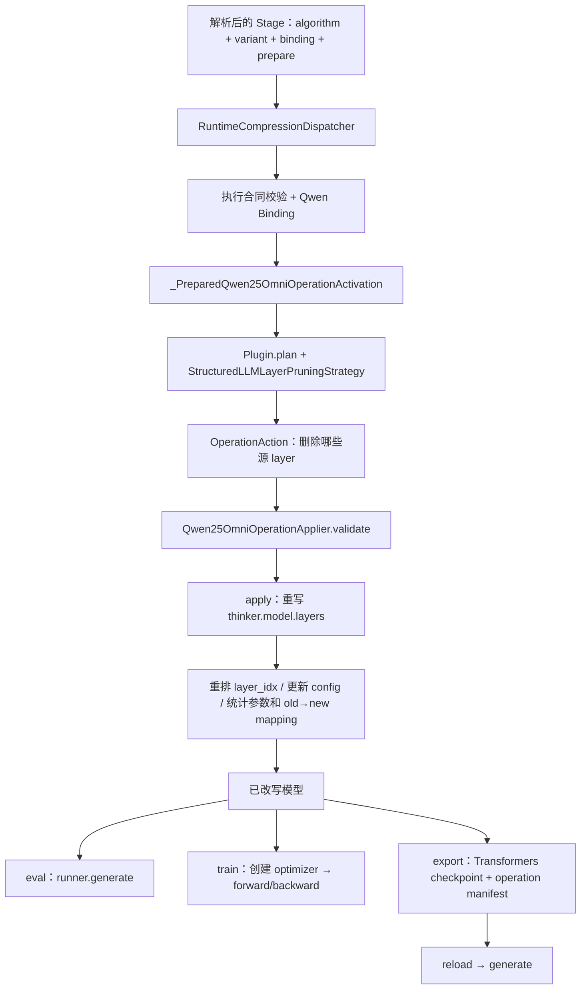

# Qwen2.5-Omni LLM-Operation SPADE：架构、扩展与最小 Debug

> 类型：Backbone-specific Architecture / Debug Reference
> 适用范围：当前静态 `llm_operation` 执行族
> 当前实例：SPADE Operation-Only（`structured_llm_layer_pruning`）
> 最后按代码核对：2026-08-24

本文回答三个问题：

1. SPADE Operation-Only 为什么在 `prepare` 阶段直接重写模型；
2. 层选择、OperationAction、Qwen OperationApplier 与导出分别负责什么；
3. 如何借助这个静态基线理解未来静态、动态和混合式 Operation。

当前实现只是 SPADE 的“给定层号后删除完整 LLM layer”子集，不包含 WLI 自动选层、teacher
或蒸馏。算法范围见[八方法契约](../eight_methods_contract.zh.md#p8)，自动验证命令见
[八方法 Runbook](../eight_methods_runbook.zh.md)。本 Omni 执行族仍只覆盖静态删层；
其他基座的方法专用动态/Mask 路径见[全框架支持范围](../../../compression_methods.zh.md)。
通用决策与分离执行的未来方向见
[Operation 重构 TODO](../../../../todo/operation_compression_execution_model.zh.md)。

## 0. 现在应该怎么读

1. 先读第 1、2 章，理解 `prepare` 与 forward/generate 的关系；
2. 再读第 3 章，区分 selector/Strategy、OperationAction、Applier 和 export；
3. 按第 4 章走一遍代码；
4. 用第 5 章判断新方法是否真能复用当前静态执行族；
5. 只有自动回归失败时，才使用第 6 章人工 Debug。

## 1. 一分钟理解当前调用链

配置解析会补齐能够唯一推导的身份；候选有歧义时必须显式选择。
下面的运行校验检查可执行工厂、phase、物理位置和模型结构。SupportUnit 单独记录支持
状态与证据；合法研究方法不需要先有 SupportUnit，也不会因一次运行自动获得正式支持。



它不等待某一次 forward 决定删哪些层。层号来自显式配置或预计算结果，因此模型加载完成后
即可物化结构；训练路径必须在 optimizer 创建前完成，以免被删参数进入 optimizer。

| 对象 | 回答的问题 | 是否包含 SPADE 选择逻辑 |
| --- | --- | --- |
| Spec / Strategy | 哪些源层被删除，配置是否属于当前静态完整层合同 | 是 |
| `OperationAction` | 用与基座无关的语义描述“删除 llm.layer[i]” | 只表达决定 |
| Qwen `OperationApplier` | 如何在 Qwen 模型中真正删层、重排并更新配置 | 否 |
| Export | 如何保存当前已物化结构并验证可重载 | 否 |
| Runtime Session / prepare activation | 何时应用、记录结果 | 否 |

## 2. `prepare`、参数加载、forward 和 optimizer

### 2.1 当前首次转换仍会加载原始完整 checkpoint

当前顺序是：

```text
from_pretrained：加载完整原始模型参数
  → prepare：删除配置指定的完整 Thinker layers
  → generate 或创建 optimizer 后训练
  → 可选 export 已裁剪 checkpoint
```

因此，首次转换不会跳过被删层参数的磁盘加载。真正从较小结构直接加载发生在导出裁剪模型
之后的 reload。不要把“被删参数不进入最终模型/optimizer”误写成“首次从原始 checkpoint
时完全不加载这些参数”。

### 2.2 Eval 与 Train 都使用各自 prepare 后的模型

- Eval：prepare 后，runner 直接对较浅模型执行 `generate()`；
- Train：ms-swift loader 在 Trainer/optimizer 创建前改写模型，之后普通 forward/backward；
- Operation 不在每次 forward 中重新执行，也没有逐样本差异；
- 当前结构重写不可逆，`uninstall()` 不恢复已删除 modules。

这只是当前静态执行能力。动态 skip/gate 的 prepare 只应安装 Controller，最终决定应发生在
forward/prefill/decode；不能照搬本手册的 structural rewrite。

## 3. 从层号到可重载模型

### 3.1 Strategy 产生语义 OperationAction

`StructuredLLMLayerPruningStrategy.plan_operations()` 检查目标层范围且不能删光所有层，然后
为每个源层产生：

```text
op=prune
target_scope=llm
target_kind=layer
module_path=llm.layer[source_index]
apply_mode=structural_rewrite
shape_effect=remove_module
requires_checkpoint_export=True
```

SPADE profile 当前只接受 `selection_source=explicit/precomputed`。如果新论文同样只是产生一组
完整层索引，应复用相同 Action 和 Applier，不新增论文专用 Qwen 删层代码。

### 3.2 Qwen OperationApplier 物化结构

`Qwen25OmniOperationApplier` 统一完成：

- 验证 action 字段、semantic module path、索引范围与唯一性；
- 从 `thinker.model.layers` 构造保留层的 `ModuleList`；
- 将保留层的 `self_attn.layer_idx` 重排为连续索引；
- 更新相关 `num_hidden_layers` 和 layer-type 配置；
- 记录 source→result layer mapping 与参数减少量；
- 验证 state dict 层索引连续；
- 返回不可逆的 `OperationApplyResult`。

Applier 不负责决定哪些层重要。层选择算法发生变化但 target/action 语义不变时，不应修改它。

### 3.3 Export/Reload 是静态 Operation 完成条件

仅在内存中 `36 → 33` 层并能 forward，不足以证明静态压缩成立。必须导出并重新加载：

```text
已改写 model + processor + apply_result
  → export_qwen25_omni_operation_checkpoint()
  → thinker_only Transformers artifact
  → operation_compression_manifest.json
  → 从导出目录重新 load model/processor
  → 层数、config、layer_idx 连续
  → reload 后 generate
```

当前 Qwen 导出限定 `thinker_only`、禁用 Talker，并复制 provider reload 所需的 `spk_dict.pt`。
Manifest/hash 是已有导出合同的一部分，用来确认导出的文件集合和 reload artifact；新增同类
selector 不需要另写一套导出器。

## 4. 最容易理解的代码阅读顺序

| 顺序 | 看什么 | 文件 / 符号 | 要回答的问题 |
| --- | --- | --- | --- |
| 1 | 公共语义 | `mllm_comp/core/actions.py::OperationAction` | 如何表达结构操作 |
| 2 | Spec 与选择 | `mllm_comp/compressors/llm_level/structured_layer_pruning.py` | 如何把层号变成 Actions |
| 3 | 方法声明与支持证据 | `mllm_comp/compressors/audio_multimodal_registry.py` | 为什么是 `llm_operation + prepare` |
| 4 | Qwen Binding / prepare activation | `mllm_comp/backbones/qwen25_omni/v2_compression.py::_PreparedQwen25OmniOperationActivation` | 物理合同满足后何时真正 apply |
| 5 | Qwen 入口 | `apply_qwen25_omni_operation_compression()` | 如何获取 structural handles 并调用 Applier |
| 6 | 结构物化 | `mllm_comp/pipeline/operation_apply.py::Qwen25OmniOperationApplier` | 如何删层、重排和更新 config |
| 7 | 训练时机 | `mllm_comp/integrations/ms_swift/training_plugin.py::_install_model_bridge` → `RuntimeCompressionDispatcher.activate()` | 为什么 prepare activation 在 optimizer 前改写 |
| 8 | 导出 | `export_qwen25_omni_operation_checkpoint()` 与 `export_operation_actions()` | 如何保存可 reload artifact |
| 9 | 证据 | `tests/unit/test_operation_compression.py`、`test_qwen25_omni_llm_token_cpu.py` | rewrite/backward/export/reload |

## 5. 如何借此理解新增 Operation 方法

### 5.1 当前静态执行族可以直接复用的范围

只有同时满足以下条件时，才可直接复用当前 Applier：

- target 是 Thinker `llm`；
- unit 是完整 `layer`；
- operation 是 `prune`；
- apply mode 是 `structural_rewrite`；
- shape effect 是 `remove_module`；
- 决策在运行前已经给定；
- 需要导出物化 checkpoint。

这时新方法主要新增 selector/Strategy，把不同打分或校准结果转成同一种 `OperationAction`。

### 5.2 不能伪装成当前静态 SPADE 的情况

以下需求需要新的执行合同：

- request/sample/hidden-dependent 动态跳层；
- 每个 decode token 改变层拓扑；
- head、FFN channel、expert 或 route；
- soft gate、可训练 mask 或混合静态/动态决策；
- replace module，而不是 remove module；
- Talker 或其他 branch。

已确定的重构原则是：统一决策接口，不统一执行机制；mask-first 可以，但保留静态物化路径。
详见[Operation 重构 TODO](../../../../todo/operation_compression_execution_model.zh.md)。当前 SPADE
应作为静态 structural rewrite 基线保留，不先退化成执行完整层后乘零的 dense mask。

### 5.3 当前多模态 v2 的职责映射

| 当前内容 | 未来归属 |
| --- | --- |
| 层重要性/选择结果 | Operation algorithm / selector |
| 语义 target 与 selected indices | OperationDecision / Action |
| Qwen ModuleList 重写 | StaticOperationApplier / Backbone Binding |
| runtime skip/gate | 独立 RuntimeOperationController |
| 静态 artifact | export/materialization policy |
| 已验证支持范围 | 精确 SupportUnit |

## 6. 重构后的最小验证与人工 Debug

### 6.1 已验证方法：先跑自动 gate

在当前 Dev workspace 及对应环境中，按[Runbook](../eight_methods_runbook.zh.md)准备后执行：

```bash
bash "$VALIDATOR" check llm
```

`check llm` 同时覆盖 SPADE 与 Audio-Pyramid；查看对应 Oracle、真实 checkpoint
推理和 backward/export/reload 的日志与报告。
没有具体失败就不再手动重复删层。

只定位 CPU 范围时：

```bash
pytest tests/unit/test_operation_compression.py
pytest tests/integration/test_qwen25_omni_llm_token_cpu.py \
  -k test_real_transformers_operation_rewrite_export_and_reload
```

### 6.2 只有失败时才沿符号定位

| 失败现象 | 首先观察的符号 | 需要确认 | 修复归属 |
| --- | --- | --- | --- |
| Stage 被当成动态 Controller | `resolve_qwen25_omni_compression_execution()` | algorithm、variant、binding、`llm_operation`、`prepare` | audio v2 registry / Binding |
| 层号或 action 错误 | `StructuredLLMLayerPruningStrategy.plan_operations()` | source layer count、Action 字段 | selector/Strategy |
| validation violations | `Qwen25OmniOperationApplier.validate()` | path、index、target/apply/shape | Action contract |
| 层已删除但 config 不一致 | `Qwen25OmniOperationApplier.apply()` | `layer_idx`、`num_hidden_layers`、layer types | Qwen Applier |
| 参数仍进入 optimizer | `_install_model_bridge()` → `RuntimeCompressionDispatcher.activate()` | prepare activation 是否在 Trainer/optimizer 前 apply | training lifecycle |
| generate/backward 失败 | 已改写模型普通 forward | retained layer/config/cache 连续性 | Qwen Applier |
| export 失败 | `export_qwen25_omni_operation_checkpoint()` | thinker-only、processor、source artifact | Qwen export binding |
| reload 层数或生成错误 | `export_operation_actions()` 后重新 load | state dict/config/layer_idx | Applier/export |

### 6.3 静态接线的七个最小断言

1. 完整 v2 身份解析到 `Binding.executor_family="llm_operation"` 与 `execution_phase="prepare"`；
2. Actions 精确对应配置中的源 layer indices；
3. apply 后层数减少且保留层 `layer_idx` 连续；
4. `num_hidden_layers`、state dict 与参数量同步；
5. 训练中 apply 发生在 optimizer 创建前；
6. 已改写模型 generate 和 backward 可用；
7. 导出后 reload 的层数/config/index 一致并能生成。

## 7. 新静态完整层方法的最小证据

新增 selector 至少需要：

1. 给定小模型时产生预期源层索引；
2. 非法索引、重复索引、删光所有层被拒绝；
3. source→result mapping、配置和参数量正确；
4. 已改写模型 generate 与 backward；
5. optimizer 不包含已删参数；
6. Transformers export、reload 与 reload 后 generate。

动态或混合式 Operation 不使用这份证据冒充支持，应按其真实 decision timing、gate/skip、cache
和 export policy 建立独立 SupportUnit 与验证。

## 8. 文档边界

- Operation 执行族总览：[Omni 执行族接入参考](../extension.zh.md)
- SPADE 当前算法范围：[八方法契约](../eight_methods_contract.zh.md#p8)
- 自动验证命令：[八方法 Runbook](../eight_methods_runbook.zh.md)
- Audio-Pyramid 动态路径：[Audio-Pyramid 架构与 Debug](llm_token_audio_pyramid.zh.md)
- 静态/动态/混合式目标设计：[Operation 重构 TODO](../../../../todo/operation_compression_execution_model.zh.md)
- 通用新增方法教程：[开发压缩方法指南](../../../../guides/2_dev_compression_method.zh.md)
- 当前状态：[Qwen2.5-Omni 状态](../../status.zh.md)

一句话总结：SPADE Strategy 决定“删哪些完整源层”；语义 Action 描述“要做什么”；Qwen
Applier 决定“如何安全物化”；export/reload 才证明静态结构压缩真正完成。
