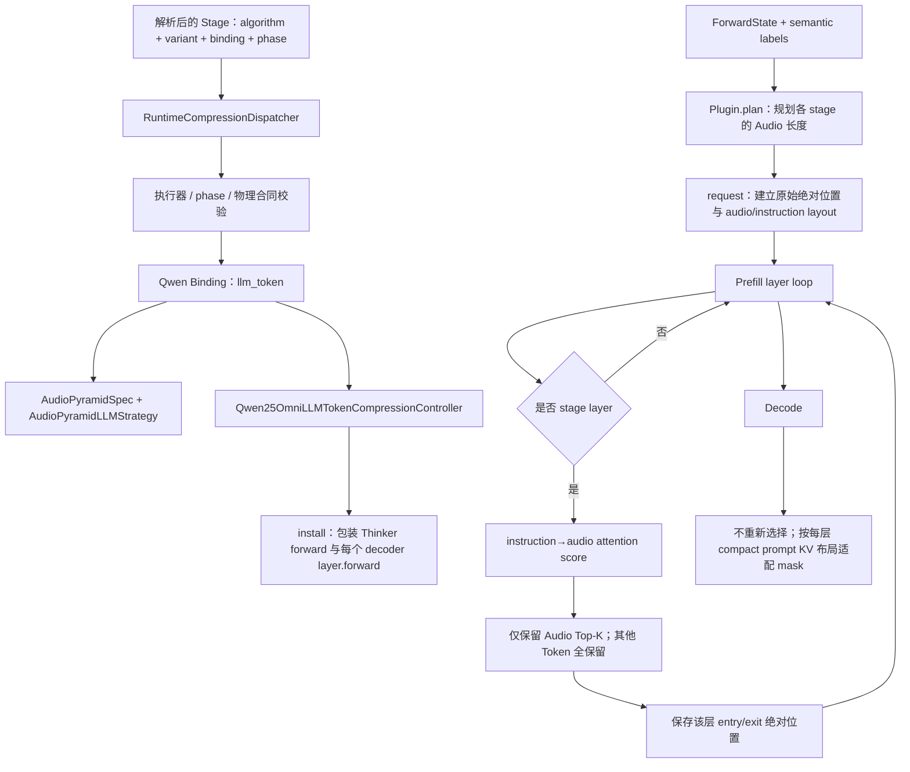

# Qwen2.5-Omni LLM-Token Audio-Pyramid：架构、扩展与最小 Debug

> 类型：Backbone-specific Architecture / Debug Reference
> 适用范围：Qwen2.5-Omni 的 `llm_token` 执行族
> 当前实例：Audio-Pyramid / Audio PDrop（`audio_pyramid_attention_pruning`）
> LLM 应用边界说明更新：2026-09-07

本文回答三个问题：

1. Audio-Pyramid 为什么只在 prefill 压缩、decode 不重复选择；
2. 算法 Strategy 与 Qwen LLM 布局/KV-cache 适配分别在哪里；
3. 如何借助这个实例理解新增 LLM-Token 方法。

Audio-Pyramid 是本项目的 AudioLLM `VARIANT`，不是 SpeechPrune 的逐项复现。算法身份与
范围见[八方法契约](../eight_methods_contract.zh.md#p7)，自动验证命令见
[八方法 Runbook](../eight_methods_runbook.zh.md)。真正新增通用压缩方法时，以
[开发压缩方法指南](../../../../guides/2_dev_compression_method.zh.md)为唯一教程。

## 0. 现在应该怎么读

如果 Audio-Pyramid 已通过 O/E/T，不需要重新证明每个 Top-K 结果：

1. 先读第 1、2 章，理解 prefill/decode 与逐层不同布局；
2. 再读第 3 章，区分 Strategy 与共享 LLM Controller；
3. 按第 4 章走一遍代码；
4. 用第 5 章理解新增 LLM-Token 方法；
5. 只有自动回归失败时，才使用第 6 章人工 Debug。

## 1. 一分钟理解当前调用链

当前 Omni 方法通过完整多模态 v2 身份进入通用 `CompressionSession`。Algorithm 内部
复用已验证的 Spec/Strategy，但不存在独立的 legacy registry/runtime 路径。

配置解析会补齐能够唯一推导的身份；候选有歧义时必须显式选择。
下面的运行校验检查可执行工厂、phase、物理位置和模型结构。SupportUnit 单独记录支持
状态与证据；合法研究方法不需要先有 SupportUnit，也不会因一次运行自动获得正式支持。



| 对象 | 回答的问题 | 是否包含 Audio-Pyramid 算法 |
| --- | --- | --- |
| Spec / Plugin | stage layers、keep ratio、最终长度是否合法 | 是 |
| `AudioPyramidLLMStrategy` | 如何打分、每阶段保留多少、选哪些 Audio Token | 是 |
| `llm_token` Controller | 如何区分 prefill/decode、维护每层布局、mask/M-RoPE/cache/labels 和 checkpoint replay | 否 |
| Algorithm + Audio Variant | 算法配置与 audio/conditioning/preserved 语义 | Algorithm 包含实现，Variant 只声明语义 |
| Qwen Binding | Strategy、target site、`executor_family` 与 phase | 声明执行约束 |
| SupportUnit | 精确身份的验证范围 | 只记录支持证据 |
| Runtime Session | 安装与卸载生命周期 | 否 |

## 2. LLM-Token 压缩为什么比 Encoder/Projector 更难

默认层号仍是算法的评分层和逐级预算来源。探索配置中的 `operation.layers` 单独移动
应用位置；完整层 site 的 `layer_edge=before` 与上一层 `after` 归一为同一层间边界。
`before` 层 0 是初始输入，不能索引最后一层。层内 site 在 Attention 残差后且 FFN 前执行。
排查时对照 `application_positions` 和 `score_layers_zero_based`，不要再假定它们层号相同。
初始压缩时 `layer_input_positions[0]` 保存 checkpoint 的原输入，
`layer_entry_positions[0]` 保存 Attention 真正看到的压缩布局；decode mask 使用后者。

### 2.1 每个 Decoder 层可能拥有不同的 Prompt 长度

默认配置在零基层 `[8, 17, 26]` 后压缩，每阶段 `keep_ratio=0.5`。如果初始有 25 个 Audio
Token，当前长度规则使用 `ceil` 且至少保留 2 个，因此形成：

```text
25 → 13 → 7 → 4 Audio Token
```

非 Audio Token 不删除。第 0–8 层、第 9–17 层、第 18–26 层和第 27 层以后看到的物理
prompt 长度不同，所以不能只在 LLM 输入前改一次 mask。

### 2.2 Prefill 选择一次，Decode 不再选择

`generate()` 的 prefill 用完整 prompt 建立每一层 KV cache。Audio-Pyramid 在 stage layer 的
输出边界删除 Audio hidden states，因此后续每层的 prompt KV 长度不同。进入 decode 后：

- 不重新计算 instruction→audio score；
- 不再次压缩 Audio Token；
- 新 Token 仍逐步追加到各层自己的 compact KV cache；
- decode attention mask 必须按该层 prefill entry layout 重建。

如果 decode 再次选择，会改变既有 KV 的物理拓扑，当前 contract 不支持这种行为。

### 2.3 保留绝对位置，而不是把序列重新编号

物理 Tensor 被 compact，但被保留 Token 的三轴 M-RoPE 继续使用原始绝对位置。Controller 用
`current_positions` 保存“当前物理槽位 → 原始序列位置”的映射，并据此 gather：

- `position_embeddings` / `position_ids`；
- prefill 与 decode attention mask；
- 训练 labels；
- instruction/audio semantic mask。

`cache_position` 描述当前物理 cache 写入位置，因此必要时按 compact 宽度重建。不要把
`cache_position` 与保留的语义绝对 M-RoPE 位置混为一谈。

## 3. Plan、Strategy 与共享 Controller

### 3.1 Plan 只规划长度

`AudioPyramid.plan()` 为每个 audio span 计算逐阶段长度，并记录：

```text
original_count
stage_lengths
final keep_count
stage_layers
lifecycle=prefill_only
selection_deferred=True
```

Plan 尚未见到 decoder hidden states，因此不知道最终保留哪些 Token。

### 3.2 Strategy 只负责算法差异

Audio-Pyramid 在 `LLMTokenStrategy` 共有接口上提供评分扩展：

```text
stage_layer_indices(num_layers)
output_length(current_length)
score_audio_tokens(...)
select_indices(scores, keep_count)
runtime_metadata(stage_layers)
```

没有层输入评分的 UniSamp/UniAvg 使用值变换和重放接口，不需要这两个评分方法。
共有接口与适配说明见[扩展文档](../extension.zh.md#5-llm-token-executor)。

Audio-Pyramid 的 score 使用 instruction query 对 Audio key 的 received attention。它根据当前
stage layer 的 normalized input、Q/K projection 和 M-RoPE 重新计算所需 attention，不要求原生
layer 返回完整 attention matrix；选择结果作用于该 layer 的输出边界。系统、消息模板、答案和
特殊 Token 都不能成为 query；缺少可证明的 instruction semantic labels 时直接失败，不回退到
其他 Token。离散 score/Top-K 可在 `no_grad` 中执行，但被 gather 的 hidden states 不得 detach。

### 3.3 Controller 负责逐层布局生命周期

`Qwen25OmniLLMTokenCompressionController` 统一负责：

- 包装所有 decoder layer 与 Thinker forward；
- 区分 prefill、decode 和训练 checkpoint replay；
- 在每层进入前按该层 layout 适配 mask、M-RoPE 和 cache metadata；
- stage boundary 后只删除 Audio hidden states；
- 保存每层 entry/exit 的绝对位置映射；
- 暴露轻量的每层入口语义布局，供压缩后 Analysis 正确分组；
- 训练时按最终 layout gather labels 后重算 loss；
- checkpoint backward 只重放已保存的整数布局，不重复打分与 report；
- 只接受当前验证过的标准 `DynamicCache`。

共享 Controller 不应增加 `if plugin == "audio_pyramid..."` 分支。

## 4. 最容易理解的代码阅读顺序

| 顺序 | 看什么 | 文件 / 符号 | 要回答的问题 |
| --- | --- | --- | --- |
| 1 | 公共接口 | `mllm_comp/compressors/strategies.py::LLMTokenStrategy` | 算法必须提供什么 |
| 2 | 方法声明与支持证据 | `mllm_comp/compressors/audio_multimodal_registry.py` | 为什么使用 `llm_token`、对应 target site 与 phase |
| 3 | Spec、长度与 score | `mllm_comp/compressors/llm_level/audio_pyramid.py` | 每阶段长度、instruction→audio score 和 Top-K |
| 4 | 共享 Qwen 执行器 | `mllm_comp/backbones/qwen25_omni/llm_token_compression.py::Qwen25OmniLLMTokenCompressionController` | 逐层 layout、prefill/decode、cache、labels 如何处理 |
| 5 | 重点边界 | `_layer_forward()`、`_compress_boundary()`、`_decode_layer()` | 何时压缩、何时绕过、如何选择 |
| 6 | layout 工具 | `_adapt_prefill_call()`、`_compact_decode_attention_mask()`、`_gather_labels()` | mask/position/loss 如何对齐 |
| 7 | Binding executor / session | `mllm_comp/backbones/qwen25_omni/v2_compression.py`、`mllm_comp/pipeline/runtime_session.py` | 已解析的 Binding 如何进入 `CompressionSession` |
| 8 | 小型证据 | `tests/unit/test_llm_level_compression.py` | prefill、decode bypass、梯度与 replay |
| 9 | Qwen 接入证据 | `tests/integration/test_qwen25_omni_llm_token_cpu.py` | Transformers decoder/cache 接入 |

## 5. 如何借此理解新增 LLM-Token 方法

### 5.1 先判断现有执行族能否表达

先回答：

1. 压缩只发生在 prefill，还是 decode 也改变既有布局？
2. output length 能否由当前长度确定？
3. score 需要哪些 query/key 角色和哪一层 attention？
4. 是否只删除一种 modality，其他 Token 必须保留？
5. 被保留 Token 使用原始绝对位置还是 compact 位置？
6. KV cache 在所有后续 decode step 中是否保持同一拓扑？

现有 Controller 适合“prefill stage boundary、确定性长度、只 compact Audio Token、保留绝对
位置、decode 不改拓扑”的方法。逐 decode token 动态压缩、KV eviction、多模态联合选择或不同
位置策略需要新的 Binding contract，不能只新增一个 Strategy。

### 5.2 从 Audio-Pyramid 学职责，而不是复制 Controller

| 当前内容 | 当前多模态 v2 归属 |
| --- | --- |
| 分阶段长度、score、Top-K | Algorithm kernel |
| Audio target、instruction conditioning、其他 Token preserved | Audio Variant |
| Qwen decoder boundary、M-RoPE、mask、DynamicCache、labels | Qwen2.5-Omni LLM Binding / legalizer |
| 当前 Binding 的执行族与算法构造 | `Binding.executor_family`、`strategy_factory` 与 Qwen executor factory |
| generate/forward | phase-exact Stage |

新增方法按“kernel → Algorithm → Variant → Binding → Stage → 证据”接入；
正式支持声明再按已验证身份建立或晋级 SupportUnit，详见[开发指南：注册自己的方法](../../../../guides/2_dev_compression_method.zh.md#4-注册自己的方法)。

## 6. 重构后的最小验证与人工 Debug

### 6.1 已验证方法：先跑自动 gate

在当前 Dev workspace 及对应环境中，按[Runbook](../eight_methods_runbook.zh.md)准备后执行：

```bash
bash "$VALIDATOR" check llm
```

`check llm` 同时覆盖 Audio-Pyramid 与 SPADE；查看对应 Oracle、真实 checkpoint
推理和 backward 的日志与报告。没有具体失败就不再逐层打断点。

只定位 CPU 范围时：

```bash
pytest tests/unit/test_llm_level_compression.py
pytest tests/integration/test_qwen25_omni_llm_token_cpu.py \
  -k test_real_transformers_prefill_decode_and_checkpoint_backward
```

### 6.2 只有失败时才沿符号定位

| 失败现象 | 首先观察的符号 | 需要确认 | 修复归属 |
| --- | --- | --- | --- |
| Stage/Controller 类型错误 | `resolve_qwen25_omni_compression_execution()` | algorithm、variant、binding、executor_family、phase | audio v2 registry / Binding |
| 无 instruction query | `_build_active_request()` | semantic labels、labels 中的 prompt 区域 | processor/training semantic bridge |
| prefill 某层宽度不符 | `_layer_forward()` | `current_positions` 与 hidden width | Controller layout |
| score/Top-K 错误 | `AudioPyramidLLMStrategy.score_audio_tokens()` / `select_indices()` | query/audio masks、M-RoPE、keep count | Strategy/kernel |
| 删除了非 Audio Token | `_compress_boundary()` | `keep_masks = valid & ~audio`、unit slots | Controller/Variant contract |
| M-RoPE 或 mask shape 错 | `_adapt_prefill_call()` | entry positions、gather 后 shape | Qwen Binding |
| decode 再次选择或 cache 错 | `_decode_layer()` | prefill complete、prompt layout、cache 类型 | Qwen Binding |
| checkpoint backward 不一致 | `_replay_layer()` | 保存的 entry/exit layout | checkpoint replay |
| loss/labels 错位 | `_thinker_forward()` / `_gather_labels()` | final positions 与 labels | training bridge |

### 6.3 重构接线的六个最小断言

1. 完整 v2 身份解析到 `Binding.executor_family="llm_token"`；
2. Controller 中 `self.strategy` 是 `AudioPyramidLLMStrategy`；
3. Plan 的 `stage_lengths` 与每次 `output_length()` 一致；
4. 每个 stage 只减少 Audio Token，绝对位置有序；
5. report 为一次 prefill、decode 不重复选择；
6. gradient checkpoint replay 使用已保存布局，且目标输入梯度有限非零。

自动 gate 与六项接线断言通过，就足以说明算法语义未变且重构接线正确。

## 7. 新 LLM-Token 方法的最小证据

新增方法至少需要：

1. 可手算 score、长度、Top-K 与 identity 测试；
2. target/conditioning/preserved Token 角色隔离；
3. 多 audio unit 与 batch layout；
4. 每个 stage 的 mask、position、labels 和物理宽度一致；
5. 一次 prefill、多次 decode、KV cache 行为；
6. 真实 checkpoint generate；
7. 声明训练支持时增加 backward 与 checkpoint replay/reload。

## 8. 文档边界

- LLM 执行族总览：[Omni 执行族接入参考](../extension.zh.md)
- Audio-Pyramid 算法范围：[八方法契约](../eight_methods_contract.zh.md#p7)
- 自动验证命令：[八方法 Runbook](../eight_methods_runbook.zh.md)
- SPADE 静态路径：[SPADE Operation 架构与 Debug](llm_operation_spade.zh.md)
- 通用新增方法教程：[开发压缩方法指南](../../../../guides/2_dev_compression_method.zh.md)
- 当前状态：[Qwen2.5-Omni 状态](../../status.zh.md)

一句话总结：Audio-Pyramid Strategy 决定“在 stage boundary 保留哪些 Audio Token”；Qwen
LLM Binding 负责“让每层不同的 compact prompt 在 prefill、decode 和 backward 中仍合法”。
