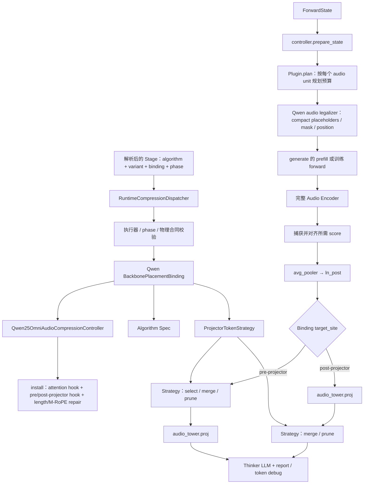

# Qwen2.5-Omni Projector-Level 音频压缩：架构、扩展与最小 Debug

> 类型：Backbone-specific Architecture / Debug Reference
> 适用范围：Qwen2.5-Omni 的 `projector_token` 执行族
> 当前实现：Segmentwise Top-K、LTBM、SA-MAP
> 最后按代码核对：2026-08-24

本文回答三个问题：

1. 广义 Projector-Level 压缩在当前代码中如何运行；
2. Segmentwise Top-K 重构后，算法、执行族和 Qwen 适配分别在哪里；
3. 如何借助这个实例理解新增 Projector-Level 方法，而不是复制一套旧实现。

本文不再维护依赖源码行号的逐断点脚本。行号会随重构失效，以下 Debug 入口全部按
稳定符号给出。Segmentwise Top-K 的算法身份和验收结论见
[八方法契约](../eight_methods_contract.zh.md#p1)，自动验证命令见
[八方法 Runbook](../eight_methods_runbook.zh.md)。真正新增通用压缩方法时，以
[开发压缩方法指南](../../../../guides/2_dev_compression_method.zh.md)为唯一教程。

## 0. 现在应该怎么读

如果 Segmentwise Top-K 已经通过 O/E/T 验证，不需要重新逐步证明 attention score、
segment budget 和 Top-K：

1. 先读第 1 章，建立当前调用链；
2. 再读第 2、3 章，区分共享执行族与 Segmentwise 算法；
3. 按第 4 章走一遍代码；
4. 用第 5 章理解未来如何新增 Projector-Level 方法；
5. 只有自动回归失败时，才使用第 6 章人工 Debug。

如果目标只是定位现有故障，直接从第 6 章开始。本文不重复 Backbone baseline、正式
benchmark、训练收敛和发布验收；这些分别由 pipeline 手册、实验协议和状态页负责。

## 1. 一分钟理解当前调用链

当前 Omni 方法通过完整的多模态 v2 身份进入通用 `CompressionSession`；Algorithm
内部仍复用已经验证的 Spec/Strategy，但不存在独立的 legacy registry/runtime 路径。

配置解析会补齐能够唯一推导的身份；候选有歧义时必须显式选择。
下面的运行校验检查可执行工厂、phase、物理位置和模型结构。SupportUnit 单独记录支持
状态与证据；合法研究方法不需要先有 SupportUnit，也不会因一次运行自动获得正式支持。



最重要的职责划分如下。

| 对象 | 回答的问题 | 是否应该包含论文方法名分支 |
| --- | --- | --- |
| Spec / Plugin | 参数是否合法、每个音频计划保留多少 Token | 是，每个算法独立 |
| Strategy | 给定 hidden states、score 和预算后如何 select/merge/prune | 是，每个算法独立 |
| `projector_token` Controller | 在哪里 hook、如何取 score、逐音频拆分、修复 placeholder/M-RoPE、生成 report | 否 |
| Algorithm + Audio Variant | 算法配置、音频语义和模态保持关系是什么 | Algorithm 内含方法实现，Variant 只声明语义 |
| Qwen Binding | 使用哪个 Strategy、target site、执行族和 phase | 声明执行约束 |
| SupportUnit | 哪些精确身份已有验证证据 | 记录支持范围，不选择执行器 |
| Runtime Session | 何时安装、卸载以及如何进入通用生命周期 | 否 |

因此：Plugin 是具体算法的配置标识；`projector_token` 是多个算法共享的执行机制。

## 2. Projector-Level 到底压缩哪里

### 2.1 Projector 是广义阶段

本项目把“Encoder 输出之后、LLM 输入之前”的压缩都归为 Projector-Level，不要求模型中
存在一个名字恰好叫 Projector 的单独模块。Qwen2.5-Omni 当前有两个物理位置：

| target site | 时机 | hook | 默认采用该位置的方法 |
| --- | --- | --- | --- |
| `audio_encoder_output_pre_projector` | `avg_pooler → ln_post` 后、`audio_tower.proj` 前 | projector pre-hook | Segmentwise Top-K、LTBM |
| `audio_projector_output_post_projector` | `audio_tower.proj` 后、拼接到 Thinker 前 | projector forward-hook | SA-MAP |

Projector-Level 方法不会提前缩短 `input_features`，也不会改变 32 层 Audio Encoder 的长度。
它们从 Encoder 已完成的 Audio Token 中选择或合并，所以主要节省 Projector 后和 LLM 中的
计算；pre-projector 方法还会减少 Projector 本身的计算。

### 2.2 `generate`、`forward`、prefill 与 decode

评估配置的 Stage 使用 `execution_phase: generate`。`generate()` 内部先执行一次完整 prompt
的 prefill forward，再反复执行 decode forward。Audio Encoder 和 Projector 只在首次处理
prompt 时运行，所以 Projector 压缩实际发生在 prefill。

训练配置使用 `execution_phase: forward`，在一次直接 forward 中运行 Encoder、Projector、
Thinker LLM 和 loss，再进入 backward。这里的 `generate`/`forward` 是外层生命周期；真正
的压缩由 Projector pre-hook 或 forward-hook 触发。

## 3. 三个代表方法如何共享一个执行族

当前七种 Projector 方法均可配置投影前后位置；下表展示三个代表方法的默认配方，
不是位置支持上限。完整位置与 HTA/UnSeg 注意事项见[执行族接入参考](../extension.zh.md#3-projector-token-executor)。

| 方法 | Plugin | Strategy | 默认 target site | 算法差异 |
| --- | --- | --- | --- | --- |
| Segmentwise Top-K | `segmentwise_topk_audio` | `SegmentwiseTopKProjectorStrategy` | pre-projector | 将时间序列分段，按最后一层 Encoder received attention 在各段保留高分 Token |
| LTBM | `local_temporal_bipartite_merging_audio` | `LocalTemporalBipartiteProjectorStrategy` | pre-projector | 在局部时间窗口做二部 cosine matching 并合并到目标预算 |
| SA-MAP | `similarity_attention_merge_prune_audio` | `SimilarityAttentionMergePruneProjectorStrategy` | post-projector | 先做相似组 merge，再结合 attention/diversity 做 pruning |

三者都实现 `ProjectorTokenStrategy`：

```text
score_source
attention_layer_offset
uses_distinct_merge_prune_importance
runtime_metadata()
compress(hidden_states, scores, keep_count, item_index)
```

共享 Controller 只依赖这个接口，不判断 Plugin 名称。Strategy 声明自己需要哪一层 attention；
Controller 负责捕获并映射 score。如果新增算法需要修改 Controller 中的 `if plugin == ...` 才能
运行，通常说明算法职责没有正确放入 Strategy，或者它需要新的物理 target site/score contract。

### 3.1 用 Segmentwise 看清 Plan 与运行时的区别

Segmentwise 的 `Plugin.plan()` 遍历原始 `ForwardState` 中每个 audio span，独立计算预算：

```text
每个音频的原始 Audio Token 数 N
  → requested K = floor(N × keep_ratio)，并应用 minimum_keep_tokens
  → allocation 计算实际 planned K
  → compact LLM audio placeholders 到 K
```

默认 `allocation=balanced_exact` 会把余数分配到各时间段，保持全局精确预算。可选的
`paper_floor` 对每段使用 `floor(K/S)`，实际保留数可能小于 requested K，因此 Plan 会分别记录
requested 和 planned budget。

Plan 此时不知道具体保留哪些 Token；`selection_deferred=True`。运行时按以下顺序决定索引：

```text
完整 Audio Encoder
  → 在所需 Encoder attention 层按原生 chunk 计算 received-attention score
  → avg_pooler 粒度对齐：相邻两个 Encoder score 取均值，E → N
  → 每个 audio unit 独立切分为时间 segments
  → 按各 segment budget 做 Top-K
  → 将所有 selected indices 恢复为全局时间顺序
  → 对 ln_post 后 hidden states 做 index_select，N → K
  → 送入 audio_tower.proj
```

Legalizer 提前在 Token ID 序列中保留每个 audio span 的前 K 个 placeholder 是正确的：audio
placeholder ID 本身不可区分。真正选中的 K 个 hidden states 已在 Projector 前恢复时间顺序，
随后按顺序填入这 K 个 compact 槽位。

### 3.2 必须保持的 Qwen 不变量

- `input_features`、`feature_attention_mask` 和完整 Audio Encoder 长度保持不变；
- 每个 audio unit 独立，多个音频不能共享预算或 score；
- Qwen 原生 attention chunk 内独立计算 received attention，不能跨 chunk 构造伪 attention；
- Encoder score 必须正确映射到 pooler 后的 Projector Token 粒度；
- 运行时每个 audio unit 的输出长度必须等于 Plan 的 `keep_count`；
- selected indices 和输出 hidden states 保持时间顺序；
- Projector 调用次数或拼接切分必须与计划的 audio units 一致；
- Projector 输出 Audio Token 数、LLM placeholder 数与 M-RoPE 输入长度一致；
- identity (`keep_ratio=1`) 保持原张量语义；
- 训练时被保留或合并的 value 路径保持 autograd。

这些属于 Backbone Binding/Controller 的接入契约，不是 Segmentwise 算法本身。

## 4. 最容易理解的代码阅读顺序

不要从旧版近 3000 行 Debug 输出或源码行号开始。按下面顺序搜索符号，每一步只回答一个问题。

| 顺序 | 看什么 | 文件 / 符号 | 要回答的问题 |
| --- | --- | --- | --- |
| 1 | 公共接口 | `mllm_comp/compressors/strategies.py::ProjectorTokenStrategy` | 执行族向算法要求什么 |
| 2 | 方法声明与支持证据 | `mllm_comp/compressors/audio_multimodal_registry.py` | Algorithm/Audio Variant/Qwen Binding/SupportUnit 如何精确对应 |
| 3 | Segmentwise 参数、预算与 Plan | `mllm_comp/compressors/projector_level/segmentwise_topk.py` | 每段预算和最终长度如何确定 |
| 4 | Segmentwise 运行算法 | `mllm_comp/compressors/projector_level/segmentwise_topk.py::SegmentwiseTopKProjectorStrategy` | 给定 score 后如何分段 Top-K |
| 5 | 共享 Qwen 执行器 | `mllm_comp/backbones/qwen25_omni/audio_compression.py::Qwen25OmniAudioCompressionController` | attention、pooler 对齐、pre/post hook、逐音频切分和 metadata 如何处理 |
| 6 | Qwen v2 调度 | `mllm_comp/backbones/qwen25_omni/v2_compression.py::create_qwen25_omni_compression_executor` | Binding 如何按 `executor_family` 选择 Controller |
| 7 | 通用生命周期 | `mllm_comp/pipeline/runtime_session.py::RuntimeCompressionDispatcher` | 已解析的 Binding 如何进入 `CompressionSession`，证据如何随运行记录保留 |
| 8 | 小型证据 | `tests/unit/test_segmentwise_topk.py` | budget、segment、Top-K、identity 和 legalizer 契约 |
| 9 | Qwen 接入证据 | `tests/integration/test_qwen25_omni_audio_compression_cpu.py` | 真实 Audio Encoder/Projector 结构上的 score 和长度修复 |

Projector 方法的压缩与 checkpoint 重放已与各自 Spec/kernel 放在同一个方法模块。`audio_method_adapters.py` 只保留跨位置执行、Qwen 原生注意力获取以及 FastSLM 的模型尺寸、设备和采样率适配。

读完第 4 步时应能单独解释 Segmentwise；读完第 5 步时应能解释为什么 LTBM 和 SA-MAP
不需要复制 Qwen hook/Legalizer；读完第 7 步时应能解释共享 v2 session 与 Qwen Binding
executor 的边界。

## 5. 如何借此理解新增 Projector-Level 方法

### 5.1 先判断是不是现有执行族能表达

先回答五个问题：

1. 压缩发生在 projector 前还是 projector 后？
2. score 来自当前 Token hidden states，还是某一层 Encoder attention？
3. 每个 audio unit 的 output length 能否在运行前确定？
4. 操作是 keep/drop 还是 merge，是否能表达完整 source-to-output 映射？
5. 输出是否保持时间顺序，并能与 placeholder、position 和其他分支同步？

如果方法能使用现有两个 site，并满足 `ProjectorTokenStrategy` 的预算与 score 接口，可以复用
当前 Projector 执行语义。如果需要改写 Projector 内部计算、联合多个模态、跨分支同步或动态
停止条件，就应设计新的 Backbone Binding/target contract，不能伪装成一个普通 Strategy。

### 5.2 从 Segmentwise 学职责，而不是复制文件

| 从当前 Segmentwise 学到的内容 | 当前多模态 v2 中的归属 |
| --- | --- |
| segment、budget、Top-K 数学 | Algorithm kernel |
| Audio Token、time-order、per-audio 语义 | Audio Modality Variant |
| Qwen attention chunk、pooler 对齐、pre-projector hook、M-RoPE | Qwen2.5-Omni Backbone Binding / legalizer |
| 当前 Binding 的执行族与算法构造 | `Binding.executor_family`、`strategy_factory` 与 Qwen executor factory |
| eval/train 配置 | phase-exact Stage |

当前 `Spec + Plugin + Strategy` 已作为 Algorithm/Binding 内部实现接入 v2；它们不构成
并行 registry。正式新增方法使用以下顺序：

```text
共享 kernel
  → AlgorithmDescriptor
  → modality-specific Variant
  → per-backbone Projector Binding
  → phase-exact Stage
  → kernel / CPU contract / real-checkpoint / backward 证据
  → 按已验证身份建立或晋级 SupportUnit
```

完整代码形状见[开发指南：注册自己的方法](../../../../guides/2_dev_compression_method.zh.md#4-注册自己的方法)。
本手册的作用是让你看懂 Projector Binding 为什么必须处理 score alignment、media units 和
LLM layout，而不是维护第二份通用教程。

## 6. 重构后的最小验证与人工 Debug

### 6.1 已验证方法：先跑自动 gate

在当前 Dev workspace 及对应环境中，按[Runbook](../eight_methods_runbook.zh.md)准备后执行：

```bash
bash "$VALIDATOR" check segmentwise
```

如果得到 Oracle、真实 checkpoint 推理和 backward 均通过的结果，说明当前重构没有破坏 Segmentwise 的算法
Oracle、真实 checkpoint 路径和 backward。没有具体失败就到此为止，不再逐层打断点。

只想快速定位 CPU 范围时，可运行：

```bash
pytest tests/unit/test_segmentwise_topk.py
pytest tests/integration/test_qwen25_omni_audio_compression_cpu.py \
  -k test_real_audio_encoder_hooks_prune_two_audio_units_before_projector
```

### 6.2 只有失败时才沿符号定位

| 失败现象 | 首先观察的符号 | 需要确认 | 确认后的修复归属 |
| --- | --- | --- | --- |
| v2 身份找不到或 Controller 类型错误 | `resolve_qwen25_omni_compression_execution()` | algorithm、variant、binding、executor_family、phase | audio v2 registry / Binding |
| Strategy 类型或参数错误 | `Qwen25OmniAudioCompressionController.__init__()` | `self.spec`、`self.strategy`、target site、attention offset | Algorithm Spec / Binding.strategy_factory |
| 压缩前 placeholder 已错 | `prepare_state()` | requested/planned keep counts、legalized state | Plugin Plan / legalizer |
| attention score 缺失或非有限 | `_capture_attention_scores()` | layer、chunk boundaries、Q/K、received score | Qwen score adapter |
| score 长度与 Projector 不同 | `_projector_scores()` | per-audio slice、pooler 的 2→1 对齐 | Qwen score adapter |
| segment/budget/Top-K 错误 | `SegmentwiseTopKProjectorStrategy.compress()` | boundaries、budgets、selected indices | Segmentwise Strategy/kernel |
| 多音频切分或输出长度错误 | `_compress_projector_tensor()` | projector call index、per-item N/K、chronological indices | shared Controller |
| hidden states 正确但 LLM 位置错 | `_compressed_output_lengths()` / `_compressed_rope_index()` | placeholder、Audio Token 数、M-RoPE | Qwen Controller/legalizer |
| forward 正常但 backward 异常 | `compress()` 与训练 bridge | selected/merged value gradient | Strategy / training bridge |
| report 与真实执行不一致 | `request()` 收尾 | projector calls、items、initial/final counts | Controller telemetry |

每次只检查能区分修复归属的变量。不要重新打印完整模型、整段 hidden states 或全部 attention；
这些输出不能帮助判断应该修改算法、Controller 还是 legalizer。

### 6.3 重构接线的五个最小断言

如果你正在人工确认这次 Strategy 重构，只需确认：

1. `segmentwise_topk_audio` 的完整 v2 身份解析到 `executor_family="projector_token"`；
2. Controller 中的 `self.strategy` 是 `SegmentwiseTopKProjectorStrategy`；
3. `Plugin.plan()` 的 planned keep count 等于运行时每个 audio unit 的输出长度；
4. `_compress_projector_tensor()` 通过 `self.strategy.compress()` 执行算法，没有 Plugin 名分支；
5. 最终 report 的 original/kept Audio Token 数与 Projector 输入输出和 compact placeholders 一致。

这五项通过且自动 O/E/T gate 通过，就足以说明“算法语义未变、重构接线正确”。

## 7. 新 Projector-Level 方法的最小证据

新增方法与已验证方法的要求不同。至少需要：

1. 小型可手算 kernel/Strategy 测试：score、budget、选择/合并、identity、顺序；
2. 多 audio unit 隔离与 concatenated/per-item Projector 调用测试；
3. Plan budget 与运行时逐音频输出长度一致；
4. Qwen CPU contract：score alignment、Projector site、placeholder、M-RoPE 和 report 一致；
5. 真实 checkpoint forward/generate smoke；
6. 只有声明训练支持时，才增加 finite loss、非零目标梯度和 checkpoint/reload 证据。

这些证据分别检测算法错误、跨媒体串流、预算错误、Backbone 接入错误和训练图错误。某项
失败时只修对应层，不因为一个新算法失败而改写整个共享 Controller。

## 8. 文档边界

- 当前四个执行族和 target site：[Omni 执行族接入参考](../extension.zh.md)
- 八方法的算法定义和允许 adaptation：[八方法契约](../eight_methods_contract.zh.md)
- 自动验证顺序与命令：[八方法 Runbook](../eight_methods_runbook.zh.md)
- 新增通用方法的唯一教程：[开发压缩方法指南](../../../../guides/2_dev_compression_method.zh.md)
- Omni 迁移到通用路径的历史记录：[Omni v2 收敛历史记录](../../../../archive/omni_compression_v2_convergence.zh.md)
- 当前运行结果和支持状态：[Qwen2.5-Omni 状态](../../status.zh.md)

一句话总结：用 Segmentwise Top-K 理解“算法 Strategy 如何插入共享 Projector 执行族”，
用通用指南真正新增方法；自动 gate 已通过时，不再重复旧版逐行 Debug。
